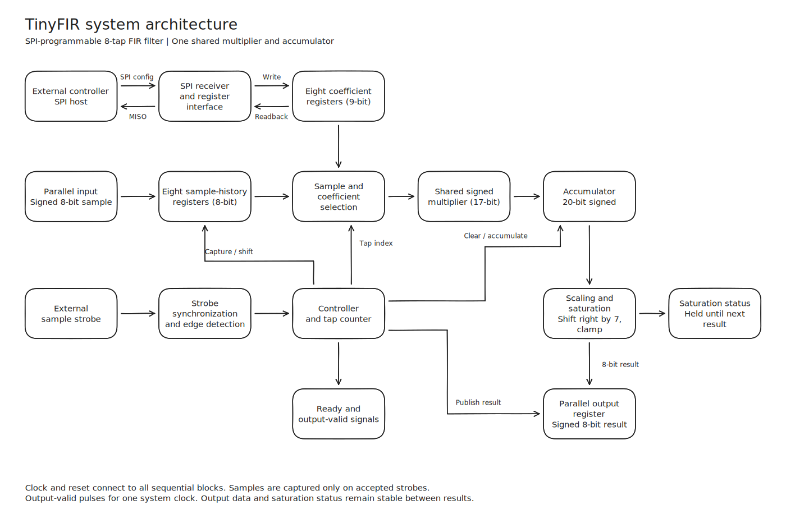
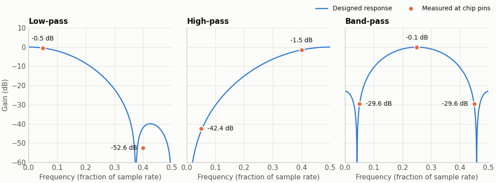
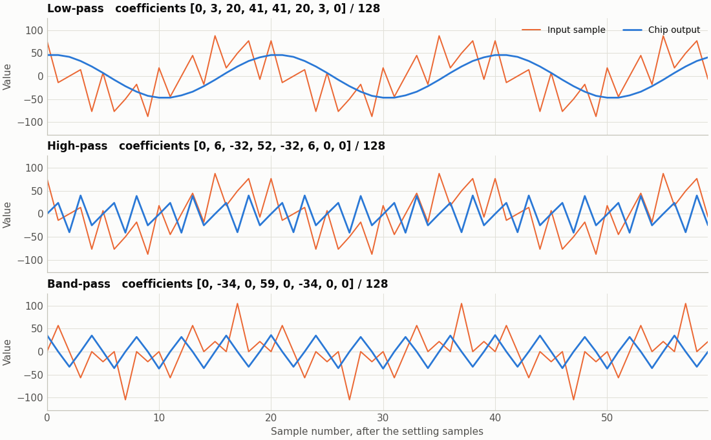
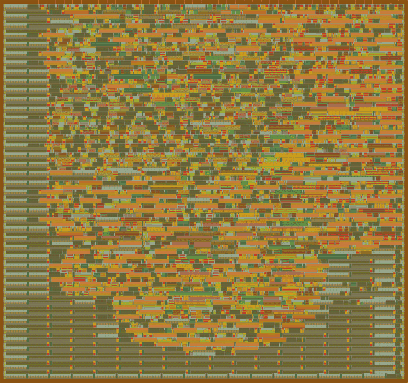

# TinyFIR Final Report

**Team:** Hamza Soofi, Gurpal Johal, Mohil Kadakia, and Ayaan Tunio  
**Status:** RTL, simulation and the official Tiny Tapeout flow all pass for commit `e200e80` on branch `heh` (CI run 42943449582). The layout meets 10 MHz at every signoff corner with at least 38 ns of setup slack.

## 1. Summary

TinyFIR is a programmable 8-tap FIR filter for a 1x2 Tiny Tapeout tile on GF180. Coefficients load over SPI, samples enter on eight parallel pins, and one shared multiplier and accumulator process the eight taps in turn.

| Measure | Target | Result | Evidence |
|---|---|---|---|
| Processing latency | At most 16 clocks | 9 clocks | Simulation at 300 random input phases |
| Sample rate at 10 MHz | 500 ksample/s | Met, with no dropped or duplicated samples | Simulation at random phases |
| Fastest contract-legal rate at 10 MHz | Not specified | 769 ksample/s (13 clocks per sample) | Simulation at random phases |
| Random arithmetic against the model | At least 10,000 samples | 10,240 samples, 1,549 of them clipped, all exact | Simulation |
| Cell area | Fit the 112,783 µm² die | 57,326 µm² of standard cells, 53.1% of the core | Final layout |
| Timing at 10 MHz (100 ns) | Met at every corner | Met at all 9 corners. Worst setup slack 38.1 ns, worst hold slack 0.19 ns | Post-route static timing |
| Physical checks | Pass | Precheck 12 of 12, Magic and KLayout DRC clean, LVS match, no antenna violations | Tiny Tapeout CI |

All 28 system tests pass on RTL, on the post-synthesis netlist, and in CI on the final placed-and-routed netlist.

## 2. Design



For each accepted strobe, the circuit captures the sample, clears the accumulator, processes one tap per clock for eight clocks, and publishes the result on the ninth. The [datasheet](info.md) has the full pinout, timing, and register map.

| Block | Source | Cell area (µm²) | Flops |
|---|---|---:|---:|
| Multiplier and accumulator | [fir_mac.v](../src/fir_mac.v) | 12,238 | 20 |
| Coefficient registers and selection | [coef_regs.v](../src/coef_regs.v) | 9,769 | 72 |
| Sample history and selection | [sample_history.v](../src/sample_history.v) | 8,812 | 64 |
| SPI interface and synchronizers | [spi_interface.v](../src/spi_interface.v) | 4,801 | 36 |
| Scaling, saturation, output register | [output_stage.v](../src/output_stage.v) | 1,240 | 10 |
| Controller and tap counter | [fir_controller.v](../src/fir_controller.v) | 766 | 6 |
| Strobe synchronizer | [strobe_sync.v](../src/strobe_sync.v) | 263 | 3 |
| Status flags | [fir_core.v](../src/fir_core.v) | 220 | 2 |
| Reset synchronizer | [reset_sync.v](../src/reset_sync.v) | 149 | 2 |
| Wrapper | [project.v](../src/project.v) | 9 | 0 |
| **Total** | | **38,267** | **215** |

These figures are from area-oriented Yosys synthesis with the `tt_025C_3v30` library, before layout. They exclude the clock tree, repair buffers, and tap cells. The flow's own synthesis came to 40,829 µm², and the final layout to 57,326 µm² (section 6).

## 3. Decisions the proposal left open

The proposal deferred these choices until implementation.

| Topic | Decision | Reason |
|---|---|---|
| SPI command byte | Bit 7 selects read, bits 6:4 must be zero, bits 3:0 are the address | Simple to decode, and it leaves room for later commands |
| Registers | `COEF0`-`COEF7` at 0x0-0x7, `STATUS` at 0x8, `CONTROL` at 0x9 | Covers everything the proposal asked for |
| Write during a calculation | Rejected and flagged, not deferred | Needs no pending-write state, and tells the host it broke the rule |
| SPI readback | Separate read mux | Reads never disturb a calculation, at a measured cost of about 1,100 µm² |
| Reset | Asserts asynchronously, releases on a clock edge | All flops leave reset in the same cycle, and gate-level simulation has no X problems |
| Strobe high through reset | `ready` stays low until the strobe is seen low | A strobe left high never captures a stray sample |
| Clock constraint | `CLOCK_PERIOD` raised from 20 ns to 100 ns | Matches the 10 MHz target. The signed-off layout needs 61.9 ns at its slowest corner (section 6) |
| Delay cells | Excluded from synthesis and place and route with `EXTRA_EXCLUDED_CELLS` | The first CI run showed the layout tool using them as buffers, which cost about 25 ns of slow-corner slack (section 6) |

Two small additions go beyond the proposal: a sticky `STATUS` flag for requests dropped while busy, and a `CONTROL` bit that clears the status flags. Both make host errors visible through the pins.

The accumulator's top bit is redundant, because the largest magnitude, 131,072, fits in 19 bits. It stays at the 20 bits the proposal specified.

## 4. Verification

There are three levels of test.

- **System tests:** 28 cocotb tests that use only the chip's pins, so the same file runs on RTL and gate-level netlists. All 28 pass on RTL, on the post-synthesis netlist, and in CI on the final placed-and-routed netlist with power pins.
- **Module tests:** 16 tests across 7 blocks, including exhaustive sweeps. All pass.
- **Reference model tests:** 29 tests that check the integer model against hand-worked values and the proposal's formula. All pass.

| Proposal test | Test name | Result |
|---|---|---|
| Reset | `test_reset_defaults`, `test_reset_during_calculation`, `test_strobe_high_through_reset_is_not_a_request` | Pass |
| SPI writes and readback | `test_spi_write_and_readback`, `test_spi_value_range`, `test_spi_invalid_commands`, `test_spi_incomplete_and_overlong`, `test_spi_timing_margins`, `test_spi_sclk_high_at_chip_select_edges`, `test_status_and_control`, `test_uio_pin_directions` | Pass |
| Impulse response | `test_impulse_response` | Pass |
| Unity pass-through | `test_unity_pass_through`, all 256 input values | Pass |
| Random arithmetic | `test_random_arithmetic`, 10,240 samples across 10 coefficient sets | Pass |
| Overflow and sign handling | `test_overflow_and_sign` | Pass |
| Variable-rate input | `test_variable_rate`, `test_fastest_contract_rate`, `test_minimum_strobe_low_time`, `test_latency_budget`, `test_strobe_contract`, `test_host_too_slow_to_watch_ready` | Pass |
| Busy handling | `test_busy_handling`, `test_coefficient_write_during_calculation`, `test_clear_history_during_calculation`, `test_spi_read_during_calculation` | Pass |
| Low-pass, high-pass, and band-pass demonstrations | `test_lowpass_demo`, `test_highpass_demo`, `test_bandpass_demo` | Pass |
| Physical implementation | Tiny Tapeout `gds`, `precheck` and `gl_test` jobs | Pass, see section 6 |

The module tests cover every legal sample and coefficient product (65,792 pairs), every value of the scaled accumulator (8,192), all 65,536 SPI data words, and all 256 command bytes.

### Do the tests catch bugs?

Passing tests only help if they would fail on a broken design. [mutation_test.py](../scripts/mutation_test.py) injects one realistic bug at a time into a copy of the RTL and runs the system tests against it.

Of 82 injected bugs, the system tests caught 78. One of those, swapping the `ready` and `output_valid` pins, was caught only by the script's time limit, because the tests stalled rather than failing quickly. The remaining 4 have no effect that the system tests can see:

- Releasing reset directly from the pin behaves the same in simulation. The synchronizer guards against metastability, which simulation cannot show.
- Bit 19 of the accumulator can never differ from the bits below it, as noted in section 3.
- Two variants let the accumulator run freely outside a calculation. It is cleared on acceptance and read before it can change, so the pins cannot show the difference. The module tests catch one of these.

An earlier run found three real gaps: nothing checked that MISO stays low during writes, that MISO is low after an aborted read, or that a legal `CONTROL` value sent to a wrong address is rejected. A separate review of the RTL against the proposal, done by an AI agent reading the code without running it, then found a few more weak or missing checks and a Makefile path error that would have broken the CI workflow. All of these are fixed. That review found no RTL violations of the proposal, but it does not replace a human design review.

## 5. Filter demonstrations

Each filter ran through the chip's pins at 500 ksample/s, on 400 samples after discarding the settling samples. Every output sample matched the reference model exactly, with no clipping.

| Filter | Coefficients (/128) | Tone (fraction of sample rate) | Designed (dB) | Measured (dB) | Limit (dB) |
|---|---|---|---:|---:|---|
| Low-pass | 0, 3, 20, 41, 41, 20, 3, 0 | 0.05, pass | -0.50 | -0.51 | At least -2 |
| | | 0.40, stop | -41.96 | -52.58 | At most -35 |
| High-pass | 0, 6, -32, 52, -32, 6, 0, 0 | 0.40, pass | -1.52 | -1.53 | At least -2 |
| | | 0.05, stop | -43.65 | -42.40 | At most -35 |
| Band-pass | 0, -34, 0, 59, 0, -34, 0, 0 | 0.25, pass | -0.07 | -0.12 | At least -2 |
| | | 0.05, stop | -30.13 | -29.55 | At most -25 |
| | | 0.45, stop | -30.13 | -29.55 | At most -25 |





The low-pass stopband measures 10 dB better than designed because its output is smaller than one output step, which the 8-bit output cannot represent. That number reflects quantization, so it should not be read as better filter performance.

The limits were set after evaluating the quantized coefficients and before final verification, as the proposal required. That evaluation changed the band-pass design. The first attempt, a windowed filter with its DC gain corrected by one tap, lost its symmetry and reached only about -15 dB at the high tone. The final seven-tap least-squares design reaches -30 dB at both outer tones. Its DC gain is -9/128, about -23 dB, which is acceptable here because the demonstration tones have no DC component.

## 6. Physical implementation

The official Tiny Tapeout flow (tt-gds-action `ttgf26c`, LibreLane 3.0.14) hardened the design in GitHub Actions. The first run, on commit `c3968f1`, passed but exposed a buffering problem, described below. Commit `e200e80` fixes it with one configuration setting, and its run, 42943449582, is the one reported here. Every job passed: `gds`, `precheck`, `gl_test` and `viewer`.



| Check | Result |
|---|---|
| Tiny Tapeout precheck | 12 of 12 checks pass, including the KLayout GF180MCU DRC deck without its density rules (0 violations across 739 rule categories) and an antenna check |
| Magic DRC | 0 errors |
| LVS | Circuits match uniquely: 1,962 devices, 1,973 nets, no unmatched pins |
| Antenna | 0 violations, no diodes needed |
| Detailed routing | 0 violations after four iterations |
| IR drop | Under 0.1 mV on either supply |
| Power | 4.53 mW at the typical corner, a vectorless estimate |
| Gate-level test | All 28 system tests pass on the final netlist with power pins |

The gate-level simulation is zero-delay, because the cell models' timing is switched off. It shows that the routed netlist passes the same 28 pin-level tests as the RTL, with every output checked exactly. It is not a formal equivalence check, and it says nothing about timing, which comes from static timing analysis alone.

### Timing

Setup and hold are met at all nine signoff corners, with no violations. The slow corners limit setup and the fast corners limit hold. At every corner, the worst register-to-register setup paths start at the tap counter, run through the sample and coefficient selection and the multiplier, and end in the accumulator.

| Corner | Setup slack, register to register | Minimum clock period | Worst hold slack |
|---|---:|---:|---:|
| Typical: `nom_tt_025C_3v30` | 69.6 ns | 30.4 ns (32.8 MHz) | 0.54 ns |
| Slow: `nom_ss_125C_3v00` | 39.5 ns | 60.5 ns (16.5 MHz) | 1.38 ns |
| Fast: `nom_ff_n40C_3v60` | 82.3 ns | 17.7 ns (56.4 MHz) | 0.19 ns |
| Slowest of all nine: `max_ss_125C_3v00` | 38.1 ns | 61.9 ns (16.2 MHz) | 1.38 ns |

The worst hold slack over all corners, 0.19 ns at `min_ff_n40C_3v60`, is between the reset synchronizer's two back-to-back flops, which is expected. Paths to and from the pins have at least 57 ns of setup slack, measured against the flow's default input and output delays of 20% of the clock period (20 ns at 100 ns), and at least 16 ns of hold and removal slack. At the typical and fast corners, the smallest setup slack overall, 58 to 59 ns, is on the `spi_cs_n` to `uio_oe[2]` pin path, because of that delay budget.

### The delay-cell fix

In the first CI run, while buffering the input pins and fixing fanout, slew and capacitance, the layout tool inserted 146 buffers of type `dlyb_1`, a delay cell. The GF180 library describes it as an ordinary buffer, and in the slow-corner library, which the flow loaded first, it ranks as the weakest buffer by 0.06%. That is the most likely reason OpenROAD picked it for the input and fanout buffers, though we have not confirmed this in the OpenROAD source. Ten of these cells sat on the worst path and made up 43.6 ns of its 88.3 ns at the slowest corner, about 25 ns more than ordinary buffers would take.

Commit `e200e80` adds the twelve delay cells (`gf180mcu_fd_sc_mcu7t5v0__dlya_1` through `__dlyd_4`) to `EXTRA_EXCLUDED_CELLS` in `src/config.json`. The second run confirmed the effect. With the delay cells excluded, the tool put `buf_1`, the next weakest buffer, in all 136 input and fanout buffers that had been `dlyb_1`, which fits the explanation above. The other 10 became `clkbuf_1`: six wire, three max-capacitance and one load-slew buffer, including five of the ten on the old worst path. The tool chose those some other way.

| Measure | First run (`c3968f1`) | Second run (`e200e80`) |
|---|---:|---:|
| Delay cells in the layout | 146 | 0 |
| Worst setup slack, slowest corner | 13.4 ns | 38.1 ns |
| Slowest-corner limit | 11.6 MHz | 16.2 MHz |
| Typical-corner limit | 23.8 MHz | 32.8 MHz |
| Standard-cell area | 60,267 µm² | 57,326 µm² |
| Max-capacitance violations | 2 | 0 |
| Max-slew pins, slowest corner | 440 | 434 |

The slack gain, 24.7 ns, matches the estimate of about 25 ns made from the library tables before the second run.

### Electrical rule warnings

The flow reports max-slew and max-fanout violations as warnings only. By default LibreLane checks slew and capacitance at no corner and has no fanout check, and Tiny Tapeout keeps those defaults.

- **Max slew:** 434 pins on 45 nets exceed the flow's 3 ns limit at the slowest corner (worst 8.3 ns), 77 pins at the typical corner (worst 4.2 ns), and none at the fast corners. At the slowest corner 96% of them, and at the typical corner all of them, are on nets driven by `buf_1` fanout buffers, which have only x1 drive. None is on a clock net. Every slew stays inside the library's characterized range, which goes up to 15.6 ns at the slow corner, so the timing above is interpolated, not extrapolated.
- **Max fanout:** 13 clock-tree leaf buffers each have a fanout of 15 to 19, counting the clock tree's dummy loads, against a limit of 10. That is normal for a clock tree.
- **Max capacitance:** none, down from 2 in the first run.

None of these causes a functional problem at 10 MHz: every setup, hold, recovery and removal check passes. Clearing the slew warnings would take stronger drivers on those nets, mostly the `buf_1` fanout buffers, though 19 of the 434 pins are on nets driven by logic cells. LibreLane's experimental post-global-route design repair (`RUN_POST_GRT_DESIGN_REPAIR`) might provide them, but it is untested here, and this design does not need it.

### Area

The flow's synthesis came to 40,829 µm², about 7% above the 38,267 µm² estimate in section 2. The final 57,326 µm² of standard cells (53.1% of the core) adds 5,655 µm² of repair buffers, 5,591 µm² from resized cells, 3,806 µm² of tap and endcap cells, and 1,444 µm² of clock tree. Fill and decap cells (50,606 µm²) take the rest of the core.

### Pre-layout estimates against signoff

Before CI ran, a quick synthesis estimate put the critical path at 12.2, 24.6 and 6.9 ns at the typical, slow and fast corners. The signed-off register-to-register paths are 30.4, 60.5 and 17.7 ns, about 2.5 times longer, and they were about 3.45 times longer before the delay-cell fix. The rest of the gap comes mainly from the flow's area-oriented synthesis, timing terms the quick estimate left out, and wire load. The estimate was good enough to choose the 100 ns constraint, but too optimistic to quote as margin.

## 7. Known limits

- **Short `ready` and `output_valid` pulses.** `ready` is low for 9 clocks and `output_valid` lasts 1. A slow polling host can miss both, so the datasheet gives a fixed-delay procedure, which `test_host_too_slow_to_watch_ready` covers.
- **Reset with SPI active.** If reset releases while chip select is low and SCLK is high, the first SCLK level counts as a clock. A write in that frame is rejected and flagged, so it fails safely. This state is outside SPI mode 0 idle.
- **Simulation cannot show metastability.** The synchronizers follow standard practice, but only silicon can test them. Gate-level simulation is zero-delay, so timing evidence comes only from static timing analysis.
- **Electrical warnings.** The max-slew and max-fanout warnings in section 6 were reviewed and accepted, and they remain in the layout.
- **No silicon testing.** Testing the chip depends on fabrication and delivery dates.

## 8. How to reproduce

```sh
pip install -r test/requirements.txt
make -C test                         # system tests
make -C test/unit                    # module tests
PYTHONPATH=model pytest model        # reference model tests
scripts/mutation_test.py             # injected-bug check, needs several minutes
```

See the [README](../README.md) and [test instructions](../test/README.md) for gate-level simulation, regenerating coefficients, and regenerating these figures.
