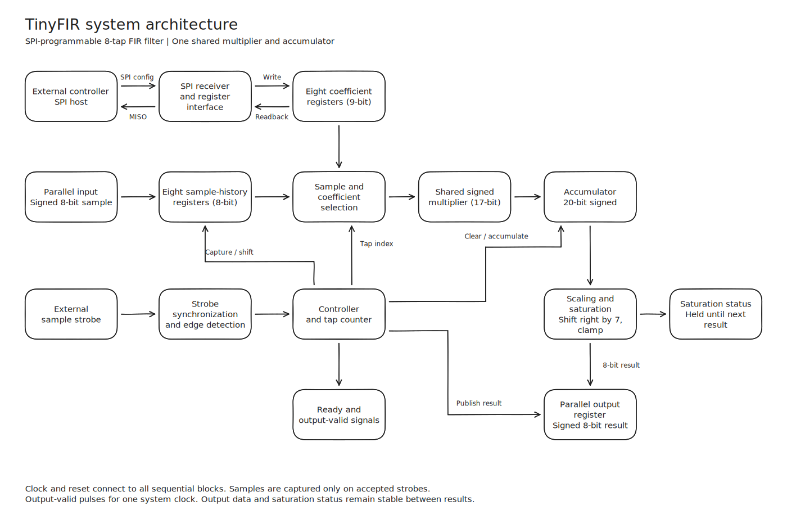
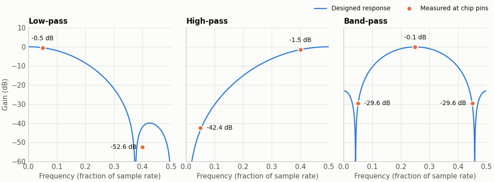
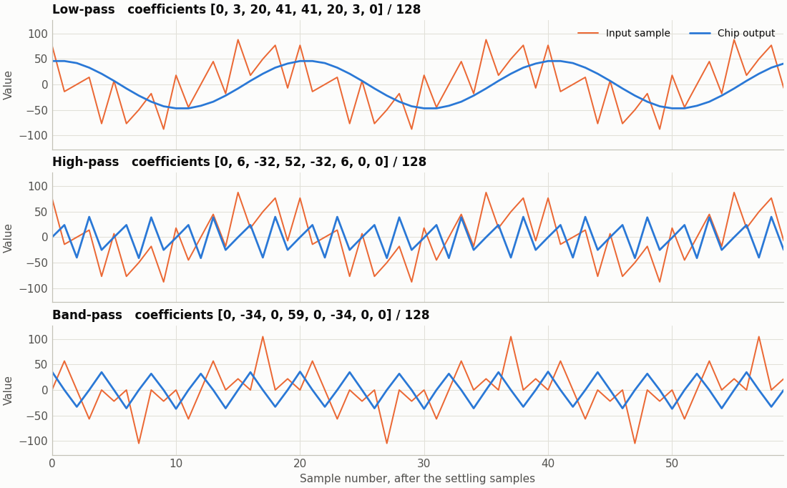

<!---

This file is used to generate your project datasheet. Please fill in the information below and delete any unused
sections.

You can also include images in this folder and reference them in the markdown. Each image must be less than
512 kb in size, and the combined size of all images must be less than 1 MB.
-->

## How it works

TinyFIR is a programmable 8-tap finite impulse response filter. It computes a weighted sum of the current input sample and the seven before it, using coefficients you load over SPI. The same hardware can act as a low-pass, high-pass or band-pass filter depending on the coefficients. Everything is digital, so any ADC or DAC is external.



### Arithmetic

Samples and results are signed 8-bit values, -128 to +127. Each coefficient is stored as a signed integer from -128 to +128 and represents that integer divided by 128, so the weights run from -1 to +1 in steps of 1/128.

For each accepted sample, one shared multiplier and a 20-bit accumulator process the eight taps in turn:

```
A = C[0]*X[n] + C[1]*X[n-1] + ... + C[7]*X[n-7]
Y = A / 128, rounded toward negative infinity, then clamped to -128..+127
```

`saturated` is high when the latest result was clamped. Keeping the weights within -1 to +1 does not prevent clamping, because several weighted samples can still add up past the output range.

After reset, the sample history and output are zero and every coefficient is 16 (a weight of 1/8), which makes an eight-point moving average.

### Timing

Times are in cycles of the system clock, `clk`, which targets 10 MHz. Samples can arrive at any rate up to the limit below. There is no fixed sampling frequency and no minimum rate.

| Event | Time |
|---|---|
| Rising edge on `sample_strobe` to acceptance | At most 3 clocks |
| Acceptance (`ready` falls) to `output_valid` | 9 clocks |
| `ready` returns | With `output_valid` |
| Maximum sample rate at 10 MHz | 500 ksample/s, one sample per 20 clocks |

`uo_out` and `saturated` update together with the one-clock `output_valid` pulse, and hold until the next result.

With fixed coefficients, the filter's response stays the same relative to the sample rate, so its cutoff in hertz moves as the sample rate changes.

### Sending samples

1. Wait for `ready` to be high.
2. Put the sample on `ui_in`, at least one clock before the next step.
3. Raise `sample_strobe`. Keep it high for at least 3 clocks.
4. Keep the data stable until `ready` falls, which acknowledges the capture.
5. Keep `sample_strobe` low for at least 3 clocks before the next request.

One rising edge causes one acceptance, so holding the strobe high does not capture again. A request made while `ready` is low is dropped, not queued, and sets the overrun flag. Only the strobe is synchronized. The chip samples the data bus directly on one clock edge, so the whole bus must be stable throughout steps 2 to 4.

A host too slow to see `ready` fall, such as a polling microcontroller, can use fixed delays instead, because `ready` is low for only 9 clocks and `output_valid` lasts one. Hold the data for 4 clocks after raising the strobe, read the result 13 clocks after raising it, and leave at least 20 clocks between strobes. Slowing `clk` also makes these pulses longer, but the SCLK limit then falls with it.

After reset, `ready` rises within 8 clocks of `rst_n` going high, provided `sample_strobe` is low. If the strobe is high, `ready` stays low until it has been seen low, so a strobe left high across reset does not capture a sample.

### SPI configuration

SPI uses mode 0, MSB first, with active-low chip select. Keep SCLK at no more than one tenth of `clk` (1 MHz at 10 MHz), with roughly equal high and low times. Leave `spi_cs_n` low for at least half an SCLK period before the first rising edge, and high for at least 5 clocks between transactions. `spi_miso` is driven only while `spi_cs_n` is low.

A transaction is exactly 24 SCLK cycles: one command byte, then two data bytes. On a read, data appears on `spi_miso` during the two data bytes, and `spi_mosi` is ignored.

| Command bit | Meaning |
|---|---|
| 7 | 1 for read, 0 for write |
| 6:4 | Must be zero |
| 3:0 | Register address |

| Address | Register | Access | Contents |
|---|---|---|---|
| 0x0-0x7 | `COEF0`-`COEF7` | Read/write | Coefficient as a sign-extended 16-bit value, -128 to +128. `COEF0` applies to the newest sample. |
| 0x8 | `STATUS` | Read | Bit 0 `ready`, bit 1 `saturated`, bit 2 write rejected, bit 3 sample overrun |
| 0x9 | `CONTROL` | Write | Bit 0 clears the sample history, bit 1 clears status bits 2 and 3. All other bits must be zero. |

A write takes effect when `spi_cs_n` rises. It is rejected, changing nothing and setting `STATUS` bit 2, if any of these is true:

- It did not have exactly 24 SCLK cycles.
- The address or reserved bits are illegal.
- The value is out of range. For example, 0x0080 (+128) and 0xFF80 (-128) are accepted, while 0x0081 and 0xFF7F are rejected.
- A calculation was running when `spi_cs_n` rose.

Reads are always safe, including during a calculation. Reading an unmapped address returns zero. The two status flags stay set until cleared through `CONTROL`. Clearing the history leaves the coefficients and the current output unchanged.

## How to test

You need an SPI host and a way to drive the sample pins. See External hardware.

**Check the chip responds.** Reset the chip with `sample_strobe` low, then read `COEF0` by sending bytes `0x80 0x00 0x00`. The last two bytes returned should be `0x00 0x10` (16). Reading `STATUS` with `0x88 0x00 0x00` should return `0x00 0x01`.

**Check the default filter.** Send the sample 80, then seven zeros. Each of the eight results should be 10, because 80 x 1/8 = 10. The next zero should give 0.

**Check pass-through.** Write +128 to `COEF0` with `0x00 0x00 0x80`, and zero to the other seven with `0x01 0x00 0x00` through `0x07 0x00 0x00`. Each output now equals the sample you sent.

**Change filters.** Stop sending samples, wait for `ready`, write and read back all eight coefficients, clear the history with `0x09 0x00 0x01`, then start sampling again.

**Run the demonstration filters.** These coefficient sets were designed for tones at the listed fractions of the sample rate, keeping the total input amplitude below clipping.

| Filter | `COEF0` to `COEF7` | Passes | Attenuates |
|---|---|---|---|
| Low-pass | 0, 3, 20, 41, 41, 20, 3, 0 | 0.05 | 0.40 |
| High-pass | 0, 6, -32, 52, -32, 6, 0, 0 | 0.40 | 0.05 |
| Band-pass | 0, -34, 0, 59, 0, -34, 0, 0 | 0.25 | 0.05 and 0.45 |

The gains below were measured in simulation at the chip's pins at 500 ksample/s, against the response calculated from the coefficients.





An attenuated tone can measure well below the designed curve when its output is smaller than one output step, because the 8-bit output cannot represent it.

## External hardware

- An SPI host and a source of sample and strobe signals. A microcontroller, such as the RP2040 on the Tiny Tapeout demo board, can do both.
- Optionally, an ADC to provide samples and a DAC to convert `uo_out` to analog. Any converter needs its own signal conditioning and must follow the sample handshake above.
- The inputs on `uio` must be driven. Leaving `sample_strobe` floating can make `ready` stay low or cause unwanted captures.
